# Mining LIMS

Mining LIMS is the laboratory management system for a geotechnical testing laboratory. It
follows one rock or soil sample from the customer's request to the approved test report:
request, invoice, payment, receiving, preparation, testing on an electronic data sheet,
review, approval and delivery of the report to the customer.

The system is built for laboratories working to **ASTM test methods** under an
**MNS ISO/IEC 17025** quality system. Every result is calculated from the recorded readings,
every status change is logged with the person and the time, and every report is signed with
the signatures of the people who tested, reviewed and approved it.

## Who uses it

| Role | What they do in Mining LIMS |
| --- | --- |
| **Customer** | Logs in to the customer portal to follow requests, see sample status and download approved reports. |
| **Technician** | Creates requests, receives and registers samples, prepares specimens and cuts them into pieces, prints labels and receipts. |
| **Engineer** | Performs the tests and records the readings on the Observation Data Sheet, imports data-logger files, looks after equipment and calibration. |
| **Head of Laboratory** | Sets prices, sends invoices, confirms payment, reviews tested samples, chooses the customer's report, maintains tests, standards and customers. |
| **Director of Centre** | Gives the final approval that releases the report to the customer. Reads everything, changes nothing else. |

## The process at a glance

```mermaid
flowchart LR
    A[Request<br/>New] -->|Head sets price| B[Request Pending<br/>Invoice e-mailed]
    B -->|Head confirms payment| C[Request Ready<br/>Samples Waiting]
    C -->|Technician accepts| D[Sample Received]
    D -->|Prepared / split into pieces| E[Sample Prepared]
    E -->|Engineer completes data sheet| F[Sample Tested]
    F -->|Head approves| G[Sample Reviewed]
    G -->|Director approves| H[Sample Approved<br/>Report e-mailed]
```

Each step has a page under **The process step by step** that explains what to do, who does
it and what the system does automatically. If you are new, read
[Login and navigation](getting-started/login-and-navigation.md) first, then follow the
process pages in order.

## How this documentation is organised

- **Getting started** - how to log in, find your way around, and the one-time setup a new
  laboratory goes through.
- **The process step by step** - the daily work, in the order it happens.
- **Forms reference** - one page per form (Request, Sample, Test ...) explaining the purpose
  of the form and the meaning of every field.
- **Reports and dashboard**, **E-mail notifications**, **Roles and permissions**, **FAQ**
  and **Glossary** for everything else.

!!! tip "Help from inside the software"
    Every form, list and report in Mining LIMS has a **Help** menu in the top bar. It opens
    the page of this documentation that matches the screen you are on. The **⋯** menu of a
    form also has a **Documentation** entry.
